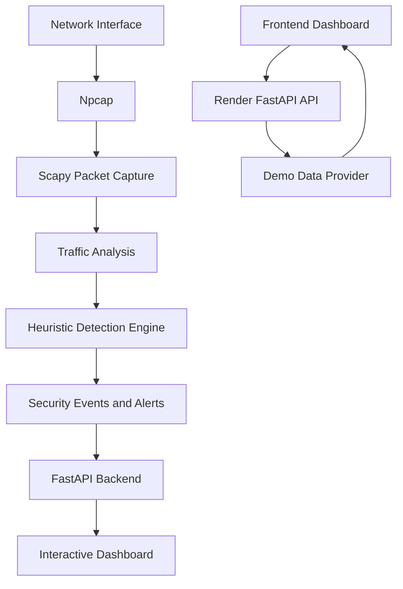

# NETWORK WATCH
### Real-Time Network Traffic Monitoring & Heuristic Intrusion Detection System

<p align="center">
  <strong>Monitor. Analyze. Detect. Protect.</strong>
</p>

<p align="center">
  A network security monitoring platform that captures live network traffic, analyzes communication patterns, identifies potentially suspicious activity, and presents network intelligence through an interactive dashboard.
</p>

<p align="center">
  <a href="https://frontend-1z130vhcc-a-001e.vercel.app">Live Demo</a> •
  <a href="https://github.com/Ayushcodes-hub/NETWORK-WATCH">GitHub Repository</a> •
  <a href="https://network-watch-api.onrender.com/api/health">API Health</a>
</p>

---

## Overview

**NETWORK WATCH** is a network monitoring and heuristic intrusion detection project designed to provide visibility into network activity and identify potentially suspicious communication patterns.

It combines packet capture, network traffic analysis, rule-based threat detection, event monitoring, and an interactive security dashboard.

Unlike a conventional dashboard that only displays network statistics, NETWORK WATCH analyzes observed traffic patterns to identify indicators such as port scanning, suspicious ports, and unusual DNS activity.

The platform supports two operating modes:

- **Live Monitoring Mode:** Captures and analyzes real network traffic on a local Windows machine.
- **Public Demo Mode:** Displays synthetic network activity through a cloud-hosted deployment, allowing anyone to explore the dashboard without accessing a real network.

## Live Application

| Component | Deployment |
|---|---|
| Frontend | [Open NETWORK WATCH](https://frontend-1z130vhcc-a-001e.vercel.app) |
| Backend API | [Render API](https://network-watch-api.onrender.com) |
| Health Check | [API Health](https://network-watch-api.onrender.com/api/health) |
| Source Code | [GitHub Repository](https://github.com/Ayushcodes-hub/NETWORK-WATCH) |

**Note:** The public deployment operates in synthetic demo mode. Real packet capture is available through the locally running application.

---

## Key Features

### 1. Real-Time Network Monitoring
- Capture network packets through Scapy and Npcap.
- Monitor network traffic on supported local network interfaces.
- Analyze TCP, UDP, ICMP, DNS, and TLS-related traffic.
- Track packet counts and traffic volume.
- Monitor network connections and interface information.

### 2. Heuristic Intrusion Detection

NETWORK WATCH uses rule-based traffic analysis to identify potentially suspicious patterns.

| Detection Rule | Description | Severity |
|---|---|---|
| Port Scan Detection | Identifies repeated TCP SYN activity across multiple destination ports. | High |
| Suspicious Port Activity | Flags communication involving configured suspicious ports. | High |
| DNS Activity Monitoring | Detects unusually high DNS request activity. | Medium |
| New Public Endpoint | Identifies newly observed public network endpoints. | Informational |

The detection engine uses configurable thresholds and observed traffic patterns to generate security events.

### 3. Security Alerts & Event Management
- Generate alerts when configured detection rules are triggered.
- Display alert severity and descriptions.
- Maintain event history.
- Review observed network activity.
- Export event and alert information as CSV files.

### 4. Network Analytics
- Visualize traffic statistics.
- Monitor packet and byte counts.
- Analyze protocol distribution.
- Review upload and download traffic.
- Explore network activity through the dashboard.

### 5. Dual-Mode Architecture

NETWORK WATCH separates real-world monitoring from its publicly accessible demonstration environment.

| Capability | Local Mode | Public Demo Mode |
|---|---|---|
| Traffic source | Actual captured packets | Synthetic traffic |
| Packet capture | Enabled when configured | Disabled |
| Network interface access | Local machine | Not exposed |
| Detection engine | Local traffic analysis | Demonstration data |
| Public accessibility | Local application | Cloud deployment |

This separation prevents the public cloud deployment from collecting or exposing the host server's actual network activity.

---

## System Architecture



### Architecture Components

**Packet Capture Layer**
- Uses Scapy for packet capture and inspection.
- Uses Npcap to access supported Windows network interfaces.
- Collects network traffic locally.

**Analysis Layer**
- Processes observed network traffic.
- Extracts relevant protocol and endpoint information.
- Maintains traffic activity information.

**Detection Layer**
- Applies heuristic rules to observed traffic.
- Identifies potentially suspicious network patterns.
- Generates security alerts and events.

**Backend Layer**
- Built with FastAPI.
- Provides API endpoints for monitoring, analytics, alerts, events, and exports.
- Supports separate local and public demo configurations.

**Frontend Layer**
- Interactive web dashboard.
- Displays network statistics, alerts, events, and analytics.
- Communicates with the backend through HTTP APIs.

---

## Technology Stack

| Category | Technologies |
|---|---|
| Programming Language | Python, JavaScript |
| Backend Framework | FastAPI |
| Packet Analysis | Scapy |
| Packet Capture | Npcap |
| Network Monitoring | psutil |
| Frontend | HTML5, CSS3, JavaScript |
| API Communication | REST API |
| Deployment | Render, Vercel |
| Version Control | Git, GitHub |
| Local Environment | Windows, Python Virtual Environment |

---

## Getting Started

### Prerequisites

For local live monitoring:

- Windows 10 or Windows 11.
- Python 3.12 recommended for the deployment environment.
- Npcap installed.
- Administrative permissions where required for packet capture.
- Git.
- A supported network interface.

### 1. Clone the Repository

```bash
git clone https://github.com/Ayushcodes-hub/NETWORK-WATCH.git
cd NETWORK-WATCH
```

### 2. Create a Virtual Environment

```powershell
python -m venv .venv
```

Activate it:

```powershell
.\.venv\Scripts\Activate.ps1
```

### 3. Install Dependencies

```powershell
pip install -r backend\requirements.txt
```

### 4. Configure Local Monitoring

Ensure the environment variable is set to disable public demo mode:

```powershell
$env:DEMO_MODE = "false"
```

### 5. Start the Backend

```powershell
python -m uvicorn backend.main:app --host 127.0.0.1 --port 8000
```

The backend will be available at:

```text
http://127.0.0.1:8000
```

API documentation, if enabled:

```text
http://127.0.0.1:8000/docs
```

### 6. Launch the Frontend

Open a second PowerShell window:

```powershell
cd D:\NETWORK-WATCH\frontend
python -m http.server 5500
```

Open:

```text
http://localhost:5500
```

Ensure the frontend API configuration points to the local backend:

```javascript
window.NETWORK_WATCH_API = "http://127.0.0.1:8000";
```

**Important:** Use the local configuration for live monitoring. The deployed frontend configuration points to the cloud demo API.

---

## Public Demo Deployment

NETWORK WATCH uses a separate deployment architecture for public demonstrations.

| Service | Platform | Purpose |
|---|---|---|
| Frontend | Vercel | Hosts the dashboard |
| Backend | Render | Hosts the FastAPI service |
| Demo Provider | Python | Supplies synthetic traffic data |
| Repository | GitHub | Source code and version control |

### Public Demo Configuration

```env
DEMO_MODE=true
FRONTEND_ORIGIN=https://YOUR-VERCEL-DOMAIN.vercel.app
```

In public demo mode:

- Synthetic network data is returned by the demo provider.
- Cloud-hosted packet capture is disabled.
- Capture-start requests are rejected.
- Real network interfaces and host traffic are not exposed through the demo API.

---

## API Endpoints

The backend provides API routes for monitoring and retrieving network information.

| Endpoint | Method | Purpose |
|---|---|---|
| `/api/health` | GET | Backend health check |
| `/api/status` | GET | Monitoring status and traffic statistics |
| `/api/capture/interfaces` | GET | Available capture interfaces |
| `/api/capture/start` | POST | Request packet capture |
| `/api/connections` | GET | Network connection information |
| `/api/interfaces` | GET | Interface information |
| `/api/alerts` | GET | Security alerts |
| `/api/events` | GET | Network events |
| `/api/analytics` | GET | Network analytics |
| `/api/history` | GET | Historical monitoring data |
| `/api/export/events.csv` | GET | Export events |
| `/api/export/alerts.csv` | GET | Export alerts |

Endpoint behavior depends on the operating mode. In public demo mode, capture operations are intentionally restricted.

---

## Security & Design Considerations

NETWORK WATCH is designed with a separation between local monitoring and public demonstration.

- Public demo mode uses synthetic traffic rather than the Render host's real network activity.
- Packet capture is intended to run locally.
- Capture requests are blocked in public demo mode.
- Cross-origin access is configured for the public frontend.
- Local environment files and generated database files should not be committed to the repository.

**Security note:** This project is an educational network monitoring and heuristic detection prototype. It is not a replacement for enterprise-grade IDS/IPS platforms, endpoint protection, or a dedicated security operations center.

---

## Current Limitations

- Detection is based on configured heuristic rules, not a trained machine-learning threat classification model.
- Heuristic alerts may generate false positives.
- Encrypted traffic payloads are generally not available for direct application-level inspection.
- Packet capture requires appropriate local permissions and Npcap configuration.
- Public demo traffic is synthetic and does not represent live internet activity.
- Render's free hosting plan may introduce cold starts after periods of inactivity.

---

## Future Enhancements

Potential future development directions include:

- Machine-learning-based network anomaly detection.
- More advanced behavioral traffic analysis.
- Geolocation and threat intelligence enrichment.
- Improved historical traffic visualization.
- Advanced DNS anomaly detection.
- Network device fingerprinting.
- Configurable alert thresholds and detection policies.
- Enhanced event correlation and incident investigation.
- Role-based authentication and access control.
- Improved reporting and security analytics.

---

## Project Objectives

NETWORK WATCH aims to demonstrate the practical application of:

1. Computer networking concepts.
2. Network packet capture and protocol analysis.
3. Python-based backend development.
4. Heuristic intrusion detection.
5. REST API design and integration.
6. Frontend dashboard development.
7. Cloud deployment and environment isolation.
8. Cybersecurity monitoring fundamentals.

---


## License

This project is intended for educational and research purposes.

Add an explicit open-source license to the repository before permitting reuse, redistribution, or modification under specific licensing terms.

---

<p align="center">
  <strong>NETWORK WATCH</strong><br/>
  Monitor Network Activity. Identify Suspicious Patterns. Improve Network Visibility.
</p>
