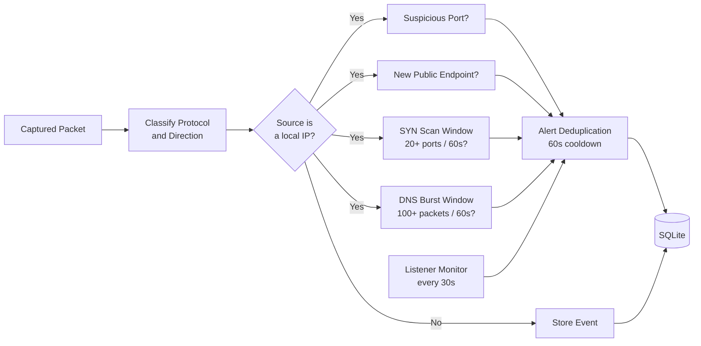
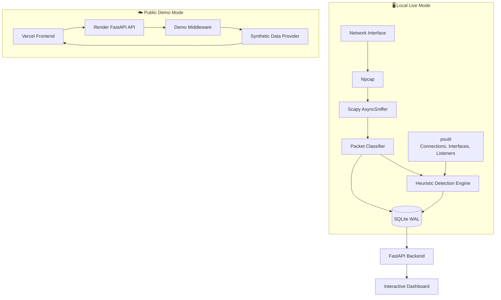
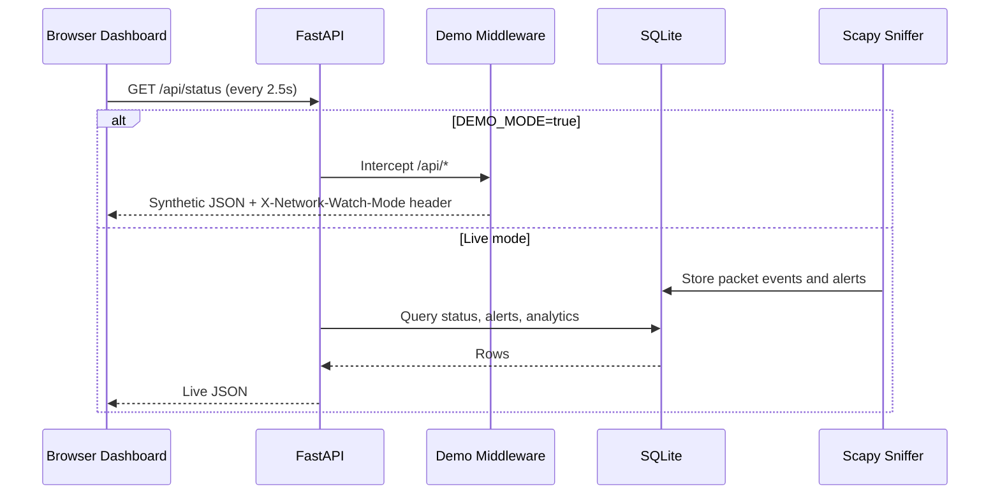
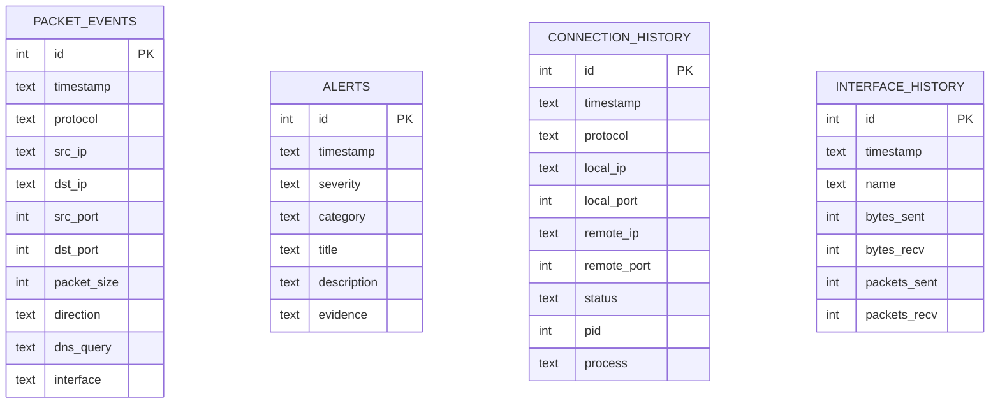

<div align="center">

# 🛡️ NETWORK WATCH

### Real-Time Network Traffic Monitoring & Heuristic Intrusion Detection System

**Monitor. Analyze. Detect. Protect.**

<br/>


<br/>

A network security monitoring platform that **captures live traffic**, **analyzes communication patterns**, **flags suspicious behavior with a heuristic detection engine**, and presents everything through a **real-time security operations dashboard**.

<br/>

[🚀 **Live Demo**](https://frontend-1z130vhcc-a-001e.vercel.app) &nbsp;•&nbsp;
[⚙️ **API Health**](https://network-watch-api.onrender.com/api/health) &nbsp;•&nbsp;
[📦 **Repository**](https://github.com/Ayushcodes-hub/NETWORK-WATCH) &nbsp;•&nbsp;
[🐛 **Report a Bug**](https://github.com/Ayushcodes-hub/NETWORK-WATCH/issues)

</div>

---

## 📑 Table of Contents

- [Overview](#-overview)
- [Live Application](#-live-application)
- [Key Features](#-key-features)
- [Detection Engine](#-detection-engine)
- [System Architecture](#-system-architecture)
- [Dual-Mode Design](#-dual-mode-design)
- [Technology Stack](#-technology-stack)
- [Project Structure](#-project-structure)
- [Getting Started](#-getting-started)
- [Configuration](#-configuration)
- [API Reference](#-api-reference)
- [Database Schema](#-database-schema)
- [Dashboard Walkthrough](#-dashboard-walkthrough)
- [Public Demo Deployment](#-public-demo-deployment)
- [Testing](#-testing)
- [Security & Design Considerations](#-security--design-considerations)
- [Current Limitations](#-current-limitations)
- [Roadmap](#-roadmap)
- [Project Objectives](#-project-objectives)
- [Contributing](#-contributing)
- [Disclaimer & License](#-disclaimer--license)

---

## 🔭 Overview

**NETWORK WATCH** is a network monitoring and heuristic intrusion detection project that gives you visibility into what your machine is talking to, and flags communication patterns that deserve a second look.

Most dashboards only *display* network statistics. NETWORK WATCH goes further: it **inspects observed packets, applies rule-based detection, and raises severity-ranked alerts** for patterns such as port scanning, connections to commonly abused ports, DNS request bursts, new external endpoints, and new listening ports on the host.

It runs in two modes:

| Mode | What it does |
|---|---|
| 🖥️ **Live Monitoring Mode** | Captures and analyzes real network traffic on your own machine using Scapy and Npcap. |
| 🌐 **Public Demo Mode** | Serves synthetic network activity from a cloud deployment so anyone can explore the dashboard without exposing a real network. |

---

## 🌍 Live Application

| Component | Platform | Link |
|---|---|---|
| 🎨 Frontend Dashboard | Vercel | [Open NETWORK WATCH](https://frontend-1z130vhcc-a-001e.vercel.app) |
| ⚡ Backend API | Render | [network-watch-api.onrender.com](https://network-watch-api.onrender.com) |
| ❤️ Health Check | Render | [`/api/health`](https://network-watch-api.onrender.com/api/health) |
| 💻 Source Code | GitHub | [Ayushcodes-hub/NETWORK-WATCH](https://github.com/Ayushcodes-hub/NETWORK-WATCH) |

> **Note:** The public deployment runs in **synthetic demo mode**. Real packet capture is only available when you run the application locally.
> Render's free plan may cold-start after inactivity, so the first request can take a short while.

---

## ✨ Key Features

### 📡 1. Real-Time Network Monitoring
- Live packet capture through **Scapy** and **Npcap** (`AsyncSniffer`, non-blocking, no packet storage in memory).
- Protocol classification for **TCP, UDP, ICMP, DNS and TLS**. TLS is recognized from the handshake record header, not by decrypting payloads.
- Both **IPv4 and IPv6** packets are handled.
- **Direction tagging** for every packet: `OUTBOUND`, `INBOUND`, or `TRANSIT/UNKNOWN`, based on the host's own addresses.
- Live counters for packets, bytes, upload, download, and per-protocol totals.
- Friendly **adapter-name resolution** to Npcap device identifiers, with a default-interface picker.

### 🚨 2. Heuristic Intrusion Detection
- Five rule-based detectors with configurable thresholds (see [Detection Engine](#-detection-engine)).
- Severity ranking: `HIGH`, `MEDIUM`, `INFO`.
- **Alert de-duplication**: the same alert is suppressed for 60 seconds so the dashboard doesn't flood.
- A baseline-aware **new listening port monitor** that doesn't spam you with every pre-existing listener.

### 🧾 3. Alerts, Events & Evidence
- Searchable, filterable **packet event explorer** (by protocol, IP, port or DNS query).
- **Security alert centre** with severity, category, description and evidence.
- Persistent history stored in **SQLite**.
- One-click **CSV export** for events and alerts (up to the latest 10,000 rows).

### 📊 4. Network Analytics
- Protocol distribution **donut chart**, drawn with the raw Canvas API and **no charting library**.
- Throughput timeline for the last hour.
- Upload vs. download volume.
- Active **connection table** with process name and PID (via `psutil`).
- **Network interface cards** with status, speed and I/O counters.

### 🎨 5. Security-Operations Dashboard
- Dark, SOC-style UI with a custom design system (CSS variables, Inter and DM Mono typography).
- Auto-refreshing panels (2.5s status, 5s events, 15s interfaces).
- Toast notifications, live clock, capture controls and sticky navigation.
- **Zero frontend dependencies**: pure HTML, CSS and vanilla JavaScript.

### 🔒 6. Safe Public Demo
- A dedicated demo provider returns synthetic data using RFC 5737 documentation IP ranges (`192.0.2.x`, `198.51.100.x`, `203.0.113.x`).
- Capture-start requests are **rejected with HTTP 403** in demo mode.
- Every demo response carries the header `X-Network-Watch-Mode: public-demo`.

---

## 🧠 Detection Engine

All detectors run against observed traffic originating from the host's own addresses.

| # | Detector | Category | Severity | Trigger |
|---|---|---|---|---|
| 1 | **Port scan pattern** | `PORT_SCAN_PATTERN` | 🔴 HIGH | A local host sends TCP SYN packets (SYN set, ACK not set) to **20 or more distinct destination ports within 60 seconds**. |
| 2 | **Suspicious port** | `SUSPICIOUS_PORT` | 🔴 HIGH | A local host communicates with a configured suspicious port: `1337, 4444, 5555, 6667, 9001, 9002, 12345, 12346, 31337`. |
| 3 | **DNS burst** | `DNS_BURST` | 🟠 MEDIUM | A local host generates **100 or more DNS packets within 60 seconds**. |
| 4 | **New listening port** | `NEW_LISTENING_PORT` | 🟠 MEDIUM | A process begins listening on a new local port after the startup baseline is established (checked every 30 seconds). |
| 5 | **New external endpoint** | `NEW_EXTERNAL_ENDPOINT` | 🔵 INFO | First observed connection from the host to a public `IP:port` pair. |



---

## 🏗️ System Architecture



### Request Flow



### Layer Responsibilities

| Layer | Responsibility |
|---|---|
| **Capture** | Scapy `AsyncSniffer` over Npcap collects packets without keeping them in memory (`store=False`). |
| **Analysis** | Extracts protocol, endpoints, ports, sizes, DNS queries and direction. |
| **Detection** | Applies heuristic rules with sliding time windows and alert cooldowns. |
| **Persistence** | SQLite in WAL mode with locks for thread-safe access and indexed queries. |
| **Backend** | FastAPI exposes REST endpoints, CSV exports, CORS and demo middleware. |
| **Frontend** | Vanilla JS dashboard that polls the API and renders tables and Canvas charts. |

---

## 🔀 Dual-Mode Design

NETWORK WATCH deliberately separates **real monitoring** from the **public demonstration**.

| Capability | 🖥️ Local Mode | 🌐 Public Demo Mode |
|---|---|---|
| Traffic source | Real captured packets | Synthetic traffic |
| Packet capture | Enabled | Disabled (`POST /api/capture/start` returns `403`) |
| Network interface access | Local machine | Not exposed |
| Detection engine | Live analysis | Demonstration alerts |
| Background workers | History and listener monitor run | Not started |
| CORS policy | Restricted to configured origins | Open for public demo reads |
| Response header | none | `X-Network-Watch-Mode: public-demo` |
| Accessibility | Your machine only | Anyone with the link |

> This separation guarantees the cloud host's real network activity is never collected or exposed.

---

## 🧰 Technology Stack

| Category | Technologies |
|---|---|
| **Languages** | Python 3.12, JavaScript (ES6+), HTML5, CSS3, SQL |
| **Backend Framework** | FastAPI, Uvicorn, Pydantic |
| **Packet Capture and Analysis** | Scapy, Npcap |
| **System Monitoring** | psutil |
| **Database** | SQLite (WAL journal mode, indexed tables) |
| **Concurrency** | Python `threading` (RLock-guarded state, DB and detection), `AsyncSniffer`, async lifespan |
| **Frontend** | Vanilla JS, Canvas API, CSS custom properties, Google Fonts (Inter, DM Mono) |
| **API Style** | REST, JSON, CSV streaming |
| **Cross-Origin** | CORS middleware plus custom demo middleware |
| **Deployment** | Render (backend), Vercel (frontend) |
| **Infrastructure as Code** | `render.yaml`, `vercel.json` |
| **Testing** | FastAPI `TestClient` smoke tests |
| **Diagrams** | Mermaid |
| **Version Control** | Git, GitHub |
| **Dev Environment** | Windows 10/11, Python virtual environment, PowerShell |

---

## 📂 Project Structure

```text
NETWORK-WATCH/
├── backend/
│   ├── __init__.py
│   ├── main.py                 # FastAPI app, capture, detection, DB, API routes
│   ├── demo_mode.py            # Synthetic data provider for public demo
│   ├── deployment_config.py    # DEMO_MODE and FRONTEND_ORIGIN settings
│   ├── test_demo.py            # 11-check demo API smoke test
│   ├── requirements.txt        # Python dependencies
│   └── data/                   # SQLite database (auto-created, git-ignored)
│
├── frontend/
│   ├── index.html              # Dashboard markup
│   ├── app.js                  # API client, rendering, Canvas charts, polling
│   ├── styles.css              # Dark SOC design system
│   ├── config.js               # API base URL for deployed frontend
│   └── vercel.json             # Vercel static hosting config
│
├── render.yaml                 # Render service blueprint
├── .env.example                # Environment variable template
├── .gitignore
└── README.md
```

---

## 🚀 Getting Started

### Prerequisites

| Requirement | Needed for |
|---|---|
| **Python 3.12** (3.10+ should work) | Everything |
| **Git** | Cloning the repo |
| **Windows 10 or 11** | Live packet capture (primary supported platform) |
| **[Npcap](https://npcap.com/)** | Live packet capture |
| **Administrator rights** | Packet capture, where required by your adapter |

> 💡 You can run the dashboard in **demo mode on any OS** without Npcap. Only live capture needs it.

### 1️⃣ Clone the Repository

```bash
git clone https://github.com/Ayushcodes-hub/NETWORK-WATCH.git
cd NETWORK-WATCH
```

### 2️⃣ Create a Virtual Environment

```powershell
python -m venv .venv
.\.venv\Scripts\Activate.ps1
```

<details>
<summary>🐧 macOS / Linux</summary>

```bash
python3 -m venv .venv
source .venv/bin/activate
```

Packet capture on Linux and macOS needs libpcap and elevated privileges. The capture layer was built around Npcap on Windows, so treat non-Windows live capture as untested. Demo mode works everywhere.

</details>

### 3️⃣ Install Dependencies

```bash
pip install -r backend/requirements.txt
```

Installs: `fastapi`, `uvicorn[standard]`, `psutil`, `scapy`.

### 4️⃣ Choose Your Mode

**🖥️ Live monitoring** (real traffic, run PowerShell as Administrator if capture fails):

```powershell
$env:DEMO_MODE = "false"
python -m uvicorn backend.main:app --host 127.0.0.1 --port 8000
```

**🌐 Demo mode** (synthetic data, no Npcap needed):

```powershell
$env:DEMO_MODE = "true"
python -m uvicorn backend.main:app --host 127.0.0.1 --port 8000
```

<details>
<summary>🐧 macOS / Linux commands</summary>

```bash
DEMO_MODE=false python -m uvicorn backend.main:app --host 127.0.0.1 --port 8000
```

</details>

### 5️⃣ Open the Dashboard

The backend serves the dashboard itself, so there is nothing else to run:

| URL | Purpose |
|---|---|
| `http://127.0.0.1:8000` | 🎨 Dashboard |
| `http://127.0.0.1:8000/docs` | 📘 Interactive Swagger API docs |
| `http://127.0.0.1:8000/api/health` | ❤️ Health check |

Pick a network interface in the **capture panel**, press **Start**, and watch traffic, events and alerts appear in real time.

### Optional: Run the Frontend Separately

If you host the frontend on its own origin (for example for development), point it at your backend by setting this in `frontend/config.js`:

```javascript
window.NETWORK_WATCH_API = "http://127.0.0.1:8000";
```

Then add that origin to `FRONTEND_ORIGIN` so CORS allows it. The HTML references assets under `/static/`, so a plain static server needs a rewrite from `/static/*` to `/*`, which is what `frontend/vercel.json` does on Vercel.

---

## ⚙️ Configuration

| Variable | Default | Description |
|---|---|---|
| `DEMO_MODE` | `false` | `true` serves synthetic data and disables capture. `false` enables live monitoring. |
| `FRONTEND_ORIGIN` | `http://localhost:5500` | Allowed CORS origin for the frontend (trailing slash is stripped). |

Copy the template to get started:

```bash
cp .env.example .env
```

```env
DEMO_MODE=true
FRONTEND_ORIGIN=https://YOUR-VERCEL-DOMAIN.vercel.app
```

### Tuning Detection

Detection thresholds and port lists live at the top of `backend/main.py` and inside `detect_packet_anomalies`:

| Setting | Default | Location |
|---|---|---|
| `SUSPICIOUS_PORTS` | `1337, 4444, 5555, 6667, 9001, 9002, 12345, 12346, 31337` | `main.py` constants |
| Port scan threshold | 20 distinct ports / 60s | `detect_packet_anomalies` |
| DNS burst threshold | 100 packets / 60s | `detect_packet_anomalies` |
| Alert cooldown | 60s per alert key | `save_alert` |
| History and listener poll | every 30s | `history_worker` |

---

## 🔌 API Reference

Base URL (local): `http://127.0.0.1:8000`  •  Interactive docs: `/docs`

| Method | Endpoint | Description |
|---|---|---|
| `GET` | `/api/health` | Service health, app name, version, DB presence |
| `GET` | `/api/status` | Capture state, packet and byte counters, per-protocol totals, local IPs |
| `GET` | `/api/capture/interfaces` | Available capture interfaces and the default device |
| `POST` | `/api/capture/start` | Start capture. Body: `{"interface": "<name>"}` (optional) |
| `POST` | `/api/capture/stop` | Stop capture |
| `GET` | `/api/connections` | Active network connections with process and PID |
| `GET` | `/api/interfaces` | Interface status, speed, addresses and I/O counters |
| `GET` | `/api/alerts?limit=100` | Security alerts (limit 1 to 1000) |
| `GET` | `/api/events?limit=150&search=&protocol=ALL` | Packet events with search and protocol filter |
| `GET` | `/api/analytics` | Protocol distribution, last-hour timeline, totals |
| `GET` | `/api/history` | Recent interface and connection history snapshots |
| `GET` | `/api/export/events.csv` | Download packet events as CSV |
| `GET` | `/api/export/alerts.csv` | Download alerts as CSV |

### Example

```bash
curl http://127.0.0.1:8000/api/alerts?limit=5
```

```json
{
  "alerts": [
    {
      "id": 12,
      "timestamp": "2026-11-20T09:41:07.321+00:00",
      "severity": "HIGH",
      "category": "PORT_SCAN_PATTERN",
      "title": "Possible port scanning activity",
      "description": "192.168.1.10 sent TCP SYN packets to 24 distinct ports in 60 seconds.",
      "evidence": "192.168.1.10"
    }
  ]
}
```

### Starting capture

```bash
curl -X POST http://127.0.0.1:8000/api/capture/start \
  -H "Content-Type: application/json" \
  -d '{"interface": "Wi-Fi"}'
```

> In **demo mode**, every `/api/*` route returns synthetic data and `POST /api/capture/start` returns `403`.

---

## 🗄️ Database Schema

NETWORK WATCH stores everything in a local SQLite database at `backend/data/network_watch.db`, created automatically on startup.



Indexes: `idx_packet_time`, `idx_alert_time`, `idx_packet_protocol`. WAL journal mode is enabled for concurrent reads and writes.

---

## 🖼️ Dashboard Walkthrough

| Section | What you get |
|---|---|
| **Network Overview** | Headline metrics: packets, bytes, upload, download and protocol counts. |
| **Capture Panel** | Interface selector with Start and Stop controls and live capture status. |
| **Analytics** | Protocol distribution donut chart and network throughput timeline. |
| **Security Alert Centre** | Severity-ranked alerts with category, description, evidence and CSV export. |
| **Active Connections** | Live socket table with local and remote endpoints, state, PID and process. |
| **Packet Event Explorer** | Searchable, protocol-filterable packet log with CSV export. |
| **Network Interfaces** | Per-adapter status, IPv4 address, link speed and traffic counters. |

> 📸 **Tip:** add screenshots to a `docs/screenshots/` folder and reference them here, for example ``.

---

## ☁️ Public Demo Deployment

| Service | Platform | Purpose |
|---|---|---|
| Frontend | **Vercel** | Static dashboard hosting |
| Backend | **Render** | FastAPI service in demo mode |
| Data | **Python demo provider** | Synthetic traffic, alerts, events |
| Source | **GitHub** | Version control and auto-deploy |

### Backend on Render

The repo ships a ready-made blueprint, **`render.yaml`**:

```yaml
services:
  - type: web
    name: network-watch-api
    runtime: python
    plan: free
    rootDir: .
    buildCommand: pip install -r backend/requirements.txt
    startCommand: uvicorn backend.main:app --host 0.0.0.0 --port $PORT
    envVars:
      - key: DEMO_MODE
        value: true
      - key: PYTHON_VERSION
        value: 3.12.8
      - key: FRONTEND_ORIGIN
        sync: false
```

1. Push the repo to GitHub.
2. In Render, choose **New → Blueprint** and select the repository.
3. Set `FRONTEND_ORIGIN` to your Vercel domain.
4. Deploy and verify `/api/health`.

### Frontend on Vercel

1. Import the repo in Vercel and set the **Root Directory** to `frontend`.
2. No build command is needed (`vercel.json` already sets `framework: null` and serves the folder as-is).
3. Make sure `frontend/config.js` points at your Render URL:

```javascript
window.NETWORK_WATCH_API = "https://network-watch-api.onrender.com";
```

### What demo mode guarantees

- Synthetic network data is returned by the demo provider.
- Cloud-hosted packet capture is disabled.
- Capture-start requests are rejected.
- Real network interfaces and host traffic are never exposed through the demo API.
- Responses are marked `Cache-Control: no-store` and `X-Network-Watch-Mode: public-demo`.

---

## 🧪 Testing

A built-in smoke test exercises the full public demo API with FastAPI's `TestClient`.

```bash
python -m backend.test_demo
```

It verifies **11 checks**: all 10 read endpoints return `200`, `POST /api/capture/start` returns `403`, every response carries the demo-mode header, and `/api/status` reports `demo_mode: true` with `capture_running: false`.

Expected output:

```text
PASS GET /api/health
PASS GET /api/status
...
PASS POST /api/capture/start

ALL 11 DEMO API CHECKS PASSED
```

---

## 🔐 Security & Design Considerations

- **Environment isolation:** public demo mode never touches the host's real traffic.
- **Capture is local by design:** capture-start requests are blocked in the cloud deployment.
- **No payload decryption:** TLS is identified from handshake headers only. Encrypted content is never inspected.
- **Parameterized SQL:** event and alert queries use bound parameters; CSV export columns are fixed server-side.
- **Bounded responses:** query limits are validated (`limit` capped at 1000; CSV export capped at 10,000 rows).
- **Thread-safe state:** dedicated locks guard database access, shared stats and detection state.
- **CORS control:** restricted to configured origins in live mode.
- **Secrets hygiene:** `.env`, local databases and logs are excluded through `.gitignore`.

> ⚠️ **Legal and ethical use:** only monitor networks you own or have explicit permission to monitor. Capturing traffic on networks you don't control may be illegal.

> **Local mode note:** live mode has no authentication. Bind it to `127.0.0.1` (as shown above) rather than exposing it to a network.

---

## ⚠️ Current Limitations

- Detection is **rule-based**, not a trained machine-learning model.
- Heuristic alerts can produce **false positives**, for example legitimate scanners or busy DNS clients.
- Encrypted traffic payloads are not available for application-level inspection.
- Live capture needs correct **Npcap** setup and sufficient permissions, and is built around Windows.
- Public demo traffic is **synthetic** and does not represent real internet activity.
- Render's free plan introduces **cold starts** after inactivity.
- No authentication or role-based access control yet.
- Packet events grow in SQLite over time, and there is no automatic retention policy yet.

---

## 🗺️ Roadmap

- [ ] 🤖 Machine-learning-based anomaly detection
- [ ] 🧬 Behavioral traffic baselining
- [ ] 🌍 GeoIP and threat-intelligence enrichment
- [ ] 📈 Richer historical traffic visualization
- [ ] 🔎 Advanced DNS anomaly detection (DGA and tunneling indicators)
- [ ] 🖧 Network device fingerprinting
- [ ] 🎚️ Configurable alert thresholds from the UI
- [ ] 🔗 Event correlation and incident investigation
- [ ] 🔑 Authentication and role-based access control
- [ ] 🗑️ Data retention and automatic database pruning
- [ ] 📄 Exportable PDF security reports
- [ ] 🔔 Email, Slack and webhook notifications
- [ ] 🐳 Docker and Docker Compose support
- [ ] ⚙️ GitHub Actions CI for tests and linting

---

## 🎯 Project Objectives

NETWORK WATCH demonstrates practical application of:

1. 🌐 Computer networking fundamentals (TCP/IP, DNS, TLS, ICMP)
2. 📦 Packet capture and protocol analysis
3. 🐍 Python backend development with FastAPI
4. 🕵️ Heuristic intrusion detection and sliding-window analysis
5. 🔌 REST API design and integration
6. 🎨 Frontend dashboard engineering without frameworks
7. 🗄️ Embedded database design with SQLite
8. ☁️ Cloud deployment and environment isolation
9. 🛡️ Cybersecurity monitoring fundamentals

---

## 🤝 Contributing

Contributions, ideas and bug reports are welcome.

1. **Fork** the repository
2. **Create** a feature branch: `git checkout -b feature/amazing-detector`
3. **Commit** your changes: `git commit -m "Add amazing detector"`
4. **Push** the branch: `git push origin feature/amazing-detector`
5. **Open** a Pull Request

Before submitting, run `python -m backend.test_demo` and confirm all checks pass.

---

## 📜 Disclaimer & License

NETWORK WATCH is an **educational network monitoring and heuristic detection prototype**. It is **not** a replacement for enterprise-grade IDS/IPS platforms, endpoint protection, or a dedicated security operations center.

This project is intended for **educational and research purposes**. Add an explicit open-source license (for example MIT) to the repository before permitting reuse, redistribution or modification under specific licensing terms.

---

<div align="center">

### ⭐ If this project helped or inspired you, please give it a star!

**NETWORK WATCH**<br/>
*Monitor network activity. Identify suspicious patterns. Improve network visibility.*

Built with 💚 by [Ayush](https://github.com/Ayushcodes-hub)

</div>
