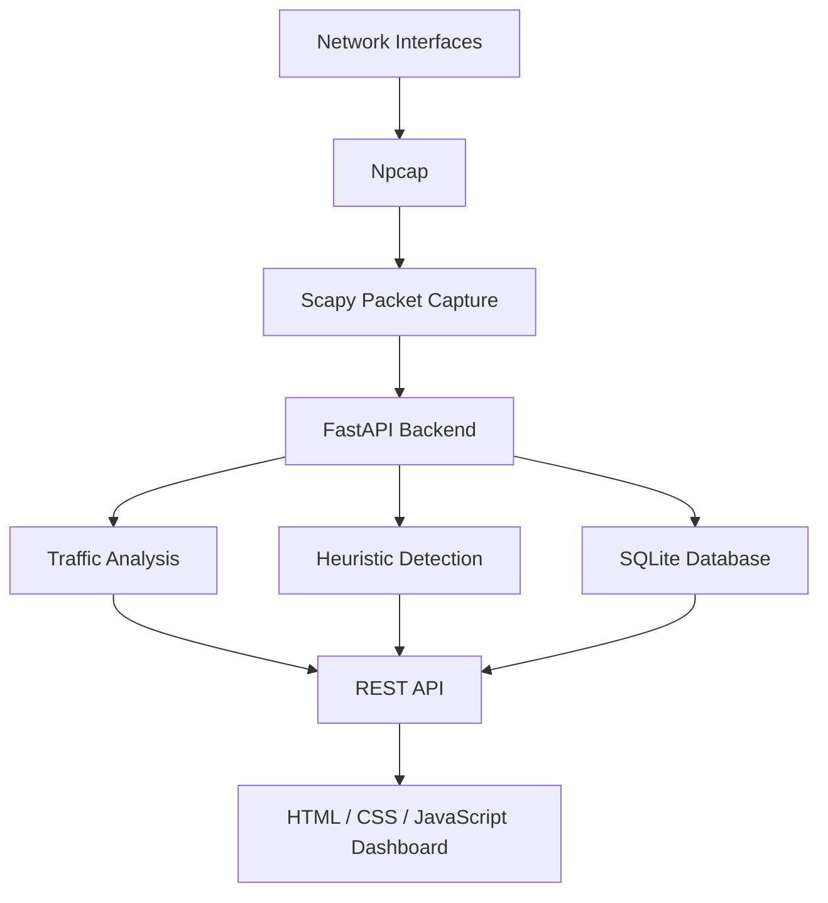

<div align="center">

# 🛰️ NETWORK WATCH

### Real-Time Network Monitoring & Heuristic Intrusion Detection Platform

NETWORK WATCH captures and analyzes live network traffic, monitors interfaces and connections, tracks protocol activity, and flags suspicious behavior through heuristic detection — all from a clean, browser-based dashboard.

[](https://github.com/Ayushcodes-hub/NETWORK-WATCH/releases/latest)
[](https://github.com/Ayushcodes-hub/NETWORK-WATCH)
[](https://www.python.org/)
[](https://fastapi.tiangolo.com/)
[](#disclaimer)

**🌐 Project Website:** [ayushcodes-hub.github.io/NETWORK-WATCH](https://ayushcodes-hub.github.io/NETWORK-WATCH/) &nbsp;•&nbsp; **🚀 Live Demo:** [frontend-1z130vhcc-a-001e.vercel.app](https://frontend-1z130vhcc-a-001e.vercel.app/)

</div>

---

## 📑 Table of Contents

- [Overview](#-overview)
- [Features](#-features)
- [Architecture](#-architecture)
- [Technology Stack](#-technology-stack)
- [Windows Installation](#-windows-installation)
- [Running from Source](#-running-from-source)
- [Online Demonstration](#-online-demonstration)
- [API Reference](#-api-reference)
- [Automated Testing](#-automated-testing)
- [Building the Executable](#-building-the-executable)
- [Security & Privacy](#-security--privacy)
- [Limitations](#-limitations)
- [Disclaimer](#-disclaimer)

---

## 🔍 Overview

NETWORK WATCH provides a unified interface for observing network activity and investigating suspicious traffic patterns in real time. It combines **packet capture**, **protocol classification**, **connection monitoring**, **historical storage**, and **heuristic detection** in a FastAPI-powered backend paired with a lightweight browser dashboard.

It ships with two operating modes:

| Mode | Purpose |
|------|---------|
| 🖥️ **Local Monitoring** | Captures real, live network traffic on the user's own machine |
| 🌐 **Public Demonstration** | Displays synthetic traffic data without touching visitor traffic |

The Windows desktop executable runs the backend locally and automatically opens the dashboard in your browser — no manual setup required.

---

## ✨ Features

### 📡 Network Monitoring
- Live network packet monitoring
- Automatic network interface discovery
- Traffic volume and packet statistics
- Upload / download traffic tracking
- Protocol categorization — TCP, UDP, DNS, TLS, ICMP, and more
- Real-time connection monitoring

### 🛡️ Security Analysis
- Heuristic port-scan detection
- Suspicious port activity monitoring
- DNS activity tracking
- Security event & alert generation
- Historical activity analysis

### 📊 Dashboard & Data
- Browser-based monitoring dashboard
- Protocol-level analytics
- Live traffic statistics
- SQLite-backed historical storage
- Full event & alert history
- One-click CSV export

---

## 🏗️ Architecture



## 🧰 Technology Stack

| Layer | Technology |
|---|---|
| Backend | Python, FastAPI |
| Packet Capture | Scapy, Npcap |
| Frontend | HTML, CSS, JavaScript |
| Database | SQLite |
| System Monitoring | psutil |
| Local Server | Uvicorn |
| Desktop Packaging | PyInstaller |
| Backend Hosting | Render |
| Frontend Hosting | Vercel |
| CI/CD | GitHub Actions |
| Project Website | GitHub Pages |

---

## 🪟 Windows Installation

### Requirements
- Windows 10 / 11, 64-bit
- [Npcap](https://npcap.com/) installed for live packet capture
- Administrator permissions (may be required for packet capture)
- A modern web browser

### 1. Download
Grab the latest build from the **[Releases page](https://github.com/Ayushcodes-hub/NETWORK-WATCH/releases/latest)**:
```
NETWORK-WATCH.exe
```

### 2. Install Npcap
Download and install Npcap from the [official site](https://npcap.com/) **before** attempting live packet capture — it's a separate system dependency and is not bundled with the app.

### 3. Run the Application
Double-click `NETWORK-WATCH.exe`. On launch, it will:

1. Check Windows permissions
2. Detect Npcap
3. Start the local FastAPI server
4. Open the monitoring dashboard
5. Begin local monitoring once initialization succeeds

> Keep the console window open while using the dashboard. Press `Ctrl+C` to shut down.
> If packet capture fails, try running the executable **as Administrator**.

### 4. Verify the Download
Each release ships with a SHA256 checksum. Verify it in PowerShell:

```powershell
Get-FileHash .\NETWORK-WATCH.exe -Algorithm SHA256
```

Compare the output against the corresponding `.sha256` file in the release assets. **Only download from the official GitHub Releases page.**

---

## 🧑‍💻 Running from Source

### Requirements
- Python 3.13 (recommended)
- Npcap (Windows, for live packet capture)
- Git
- A modern web browser

### Clone & Set Up

```bash
git clone https://github.com/Ayushcodes-hub/NETWORK-WATCH.git
cd NETWORK-WATCH
```

```powershell
py -3.13 -m venv .venv
.\.venv\Scripts\Activate.ps1
```

### Install Dependencies

```bash
python -m pip install --upgrade pip
pip install -r backend/requirements.txt
```

### Launch

```bash
python -m uvicorn backend.main:app --host 127.0.0.1 --port 8000
```

Then open **[http://127.0.0.1:8000](http://127.0.0.1:8000)** in your browser.

---

## 🌐 Online Demonstration

The hosted demo runs entirely on **synthetic network data** and is fully isolated from local live monitoring — it never captures a visitor's real traffic.

| | |
|---|---|
| **Frontend** | [frontend-1z130vhcc-a-001e.vercel.app](https://frontend-1z130vhcc-a-001e.vercel.app/) |
| **Backend** | [network-watch-api.onrender.com](https://network-watch-api.onrender.com/) |

---

## 📡 API Reference

The FastAPI backend exposes the following REST endpoints:

| Endpoint | Purpose |
|---|---|
| `/api/health` | Backend health & database status |
| `/api/status` | Monitoring and traffic statistics |
| `/api/interfaces` | Available network interfaces |
| `/api/alerts` | Security alerts |
| `/api/events` | Recorded monitoring events |
| `/api/analytics` | Traffic analytics |
| `/api/connections` | Connection information |
| `/api/history` | Historical monitoring information |
| `/api/export/events.csv` | Export events as CSV |
| `/api/export/alerts.csv` | Export alerts as CSV |

Interactive Swagger docs are available at:
```
http://127.0.0.1:8000/docs
```

---

## ✅ Automated Testing

The repo includes a regression suite for the public demo mode:

```bash
python -m backend.test_demo
```

**Coverage (11 checks):**
- Health endpoint availability
- Monitoring status endpoint
- Alerts and events
- Analytics and connections
- Interface and history endpoints
- CSV export endpoints
- Public demo packet-capture restrictions
- Public demo response isolation

---

## 📦 Building the Executable

Built with **PyInstaller**:

```bash
pip install -r backend/requirements.txt
pip install pyinstaller
```

```powershell
python -m PyInstaller `
    --noconfirm `
    --clean `
    --onefile `
    --console `
    --name NETWORK-WATCH `
    --add-data "frontend;frontend" `
    --collect-all scapy `
    --collect-all fastapi `
    --collect-all uvicorn `
    --collect-all starlette `
    --hidden-import backend.demo_mode `
    --hidden-import backend.deployment_config `
    run_app.py
```

Output: `dist/NETWORK-WATCH.exe`

> GitHub Actions automatically builds and releases the Windows executable whenever a version tag beginning with `v` is pushed.

---

## 🔐 Security & Privacy

- The local desktop app binds its monitoring server to `127.0.0.1` only
- Local monitoring data stays in a local SQLite database on your machine
- The public demo uses **synthetic data only**
- The public demo **blocks** all live packet-capture requests
- Npcap must be installed separately for Windows packet capture

> ⚠️ **NETWORK WATCH is designed for authorized network monitoring only.** Only monitor networks and devices you have explicit permission to observe.

---

## ⚠️ Limitations

- Detection is **heuristic**, not signature-complete or ML-based
- Alerts may include false positives
- Packet capture depends on OS permissions and Npcap configuration
- Not a replacement for an enterprise SIEM, firewall, or production-grade IDS/IPS

---

## 📄 Disclaimer

NETWORK WATCH is an **educational** network monitoring and heuristic intrusion detection project, intended for authorized testing, learning, and network visibility.

**Use responsibly and comply with all applicable laws and network policies.**

---

<div align="center">

**NETWORK WATCH** · Network Monitoring · Traffic Analytics · Security Visibility

[Repository](https://github.com/Ayushcodes-hub/NETWORK-WATCH) · [Latest Release](https://github.com/Ayushcodes-hub/NETWORK-WATCH/releases/latest) · [Project Website](https://ayushcodes-hub.github.io/NETWORK-WATCH/)

</div>
